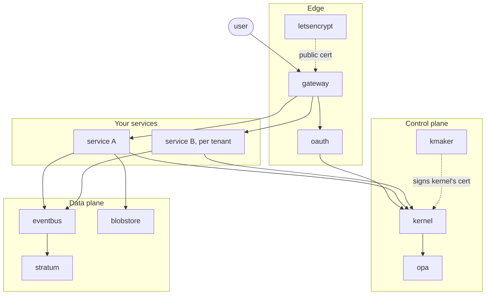

# How a fleet works

A fleet is a set of generated services running together on one Kubernetes
cluster under one trust domain. This page follows the four things every fleet
does: give each service an identity, route a call, keep state, and come up
from nothing. The repositories named here are described in
[The pieces](pieces.md).

## 1. Identity and tokens

Every principal in a fleet has a SPIFFE identity under the fleet's trust
domain, and the identity is derived from the token's claims, never carried
loose. The layout is fixed:

| Who | Identity |
|---|---|
| A shared service | `spiffe://<td>/system/services/<name>` |
| A tenant's instance of a service | `spiffe://<td>/tenants/<tenant>/services/<name>` |
| A user inside a tenant | `spiffe://<td>/tenants/<tenant>/users/<user>` |
| A user outside every tenant | `spiffe://<td>/users/<xid>` |
| A workload a service spawned | the parent's identity plus `/workloads/<name>` |

**The kernel is the one token authority.** It signs every service-to-service
and client-to-service token and issues ordinary service TLS certificates.
Nothing else in the fleet holds a signing key; oauth, for example, has none.

**A service bootstraps from its Kubernetes identity.** At start, the generated
ServiceManager reads the pod's projected service-account token and presents
it to the kernel. The kernel verifies it with the Kubernetes TokenReview API,
maps the namespace and service account to a registered delegate, and mints a
refresh token and an access token. When the service needs to call another
service, it exchanges the refresh token for an access token with that
service's audience. All of this is generated; the handler never sees a token.

**The kernel itself bootstraps from kmaker.** Before the kernel can mint
anything it needs a certificate. kmaker is a small CA that verifies the kernel
pod's service-account token and signs its certificate under the cluster
signing CA the operator provisioned. kmaker deliberately starts outside the
normal kernel-backed path, because it is what the kernel needs first.

**Users come in through oauth.** oauth is the only service that validates
tokens not issued by the kernel. It brokers the login with the identity
provider, then asks the kernel to mint the user's token. The kernel asks opa to
turn the provider's claims into entitlements before it signs. Clients that
exist before any tenant does use a credential pair the operator renders into
the kernel's bootstrap config.

**Authorization is in the proto.** Each rpc's annotations say which principal
type may call it, whether it is exposed to users or only to services, and
which field names the tenant it is scoped to. The generated server wrapper
enforces that before the handler runs. A service that calls another must
declare the dependency, and the fleet build stamps each service's allowed
caller list from what the fleet actually contains.

## 2. Routing a call

**The gateway is the edge.** It terminates TLS, speaks REST and gRPC, and
proxies to the services behind it. For every message it extracts the frame,
deserializes it, validates it against the same annotations the server will
check, verifies the token and that its audience matches the target, records a
trace, and forwards the bytes. The REST side is generated: the gateway's
routes table comes out of the same compile as the services. Backend
connections use mTLS with the cluster CAs, bootstrap and the live ones the
kernel publishes.

**It knows where every instance is from the kernel.** The gateway watches the
kernel's service-health state and keeps a live map of healthy endpoints. A
request is matched against the routes table, or falls back to routing by
SPIFFE path. Nothing is configured by hand when a service scales.

**A tenant-owned service is routed by the caller's token.** Some services run
once per tenant. The operator deploys them as `<service>-<tenant>`, and each
instance's SPIFFE identity says which tenant it serves. When a call arrives
for such a service, the gateway reads the tenant from the caller's token
namespace and dials that tenant's instance. The instance checks the same thing
at its own door. [tenantecho](https://github.com/tacplus-dev/tenantecho) exists
to prove this: its reply names the tenant that served it and the tenant that
called, and a mismatch is visible in the response.

**letsencrypt gives the gateway its public certificate.** It runs the ACME
exchange inside the cluster, keeps the one durable copy of the certificate as
a record in stratum, and mirrors the live copy into kernel state, which the
gateway watches.

## 3. State

There are three kinds of state in a fleet, and a service declares which kind
each piece of its state is.

**Live state is hosted in the kernel.** A state root labelled `kernel` lives in
the kernel's in-memory cluster, behind generated get, set and watch services.
Service configuration, service health, the policy state opa reads, the
certificate the gateway serves: all of it is here, and every reader watches
rather than polls. The kernel holds no user data and does no durability beyond
its own identity snapshot and lock log. It is the fleet's working memory, not
its disk.

**Durable records go through the event bus into stratum.** A record type
declared in a proto gets a topic. A service writes a record by publishing it;
there is no write rpc, because stratum subscribes to every record topic and
stores what arrives. Records are event-sourced and the read plane is
read-only. Stratum keeps them with three durability legs: in-memory
replication, the writers' own volumes with a redo log and checkpoints, and the
event log itself. Reads go through a generated query plane, and a service may
read only the rows it declared it may read. The bus is embedded Kafka in KRaft
mode; it takes no client connections, every publish and subscribe is a
generated, authenticated call.

**Bytes go to the blob store.** Content-addressed, mirrored across two pods
with their own volumes, uploaded and fetched over paths the gateway proxies,
with the metadata kept as stratum records.

## 4. Standing up a cluster

**A service is generated alone; a fleet is declared in a deployment repo.** Each
service compiles in its own repository against its own proto, the system
contract and the protos of its declared dependencies. A fleet is one
`fleet.yaml` in a deployment repository: the registries it trusts, the
tacplus version floor, and for each service the repository that implements it.

**`tacplus fleet build` resolves the fleet.** It unions the registries, resolves
every service's implementation at its version, checks that every dependency
of every service is present, merges all the protos into one tree, stamps the
caller lists, runs the whole-fleet checks, and writes `fleet.lock`: the exact
commit of every registry and service. Service binaries are not built here;
each builds in its own repository from the lock's commit.

**The operator renders the cluster.** The operator is a library a deployment
repository builds its own operator from, against its own merged protos, so the
binary knows exactly the services its fleet runs. It generates Helm charts for
every service and either applies them to a live cluster or writes them to
disk. Its inputs are an `operator.yaml` with the topology, FQDN, tenants,
optional services and root credential pairs, and a `crypto.yaml` with the PKI
material that is never committed. It reads the kernel's tenant records and
renders a per-tenant instance of every tenant-owned service.

**The boot order follows the identity story.** kmaker comes up and signs the
kernel's certificate. The kernel comes up and starts hosting state and every
service's configuration. Every other service bootstraps through its generated
ServiceManager against the kernel, obtains its tokens and TLS, and registers
its health. The gateway watches that health and starts routing.

[Run a fleet](run.md) does this on a disposable cluster.
