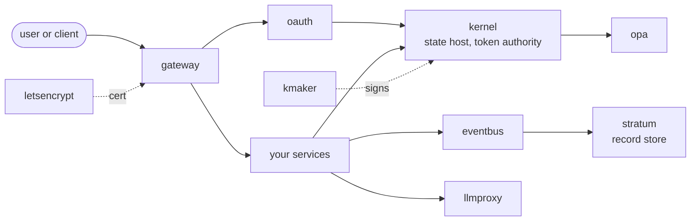

# tacplus

An open-source fleet. Protobuf in, a running platform out.

tacplus is everything it takes to stand up and run a fleet of services on
Kubernetes. You describe each service in annotated Protocol Buffers. The
compiler generates it in Go, Rust or Java: validation, identity, authorization,
state, clients, MCP tools. The platform services run the result as a fleet:
one token authority, one edge, one event bus, one record store, one policy
engine, tenant isolation checked at the door. Every repository under
[github.com/tacplus-dev](https://github.com/tacplus-dev) is part of it, and all
of it is Apache-2.0.

[Run a fleet](run.md){ .md-button .md-button--primary }
[Build a service](build.md){ .md-button }
[What it does](features.md){ .md-button }
[Why tacplus](why.md){ .md-button }
[GitHub](https://github.com/tacplus-dev){ .md-button }

## What you get

-   :material-code-braces:{ .lg .middle } **A compiler**

    ---

    `tacplus build` turns a proto set with `spec` annotations into a complete
    service: the handler interface is yours, everything around it is
    generated, in every full-service language at parity.

    [:octicons-arrow-right-24: Build a service](build.md)

-   :material-server-network:{ .lg .middle } **A platform**

    ---

    Kernel, gateway, eventbus, stratum, opa, oauth, letsencrypt, kmaker, the
    operator library and llmproxy: the services every fleet needs, each in its
    own repository with its own README.

    [:octicons-arrow-right-24: The pieces](pieces.md)

-   :material-ship-wheel:{ .lg .middle } **A way to run it**

    ---

    A deployment repository holds one `fleet.yaml`. `tacplus fleet build`
    resolves every service, merges the protos, checks the whole fleet and
    writes the lock. The operator renders the cluster from that.

    [:octicons-arrow-right-24: Run a fleet](run.md)

-   :material-swap-horizontal:{ .lg .middle } **A way to replace any of it**

    ---

    The registry decides a service's name and id. The fleet manifest decides
    which implementation runs. A fleet may run its own kernel, open or closed,
    under the same name and number.

    [:octicons-arrow-right-24: Replace a piece](replace.md)

## The shape of it

Every arrow is a generated client calling a generated server, authenticated
with a token kernel minted and authorized by the annotations in the proto.
[How a fleet works](how.md) follows a call through it.

## Where the detail lives

This site explains the whole. Each repository's README holds its own detail,
and the compiler repository's `docs/` is the reference for the generated code.
The rule for what is here is simple: if it is on GitHub under tacplus-dev, it
is open source and part of tacplus.
